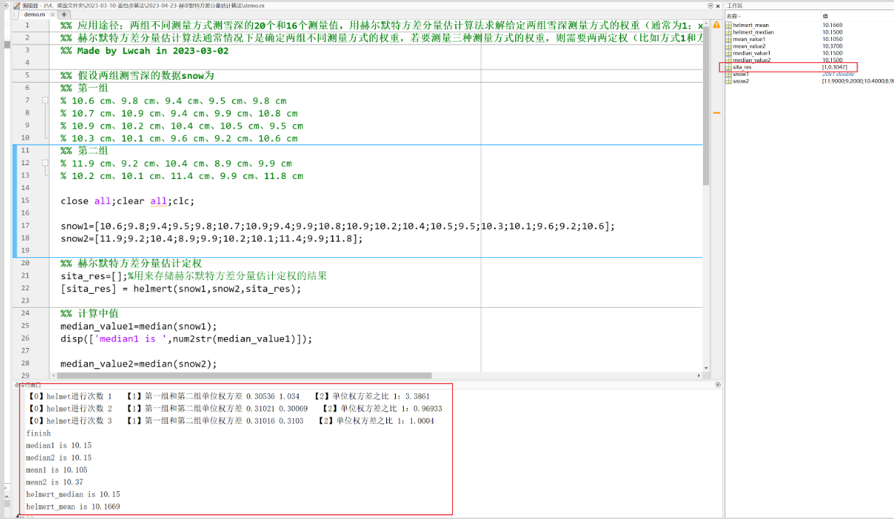

# MATLAB | Hermite Variance Component Estimation Algorithm

1. Introduction to the article
DOI: 10.1109/TGRS.2023.3265508
Link: https://ieeexplore.ieee.org/document/10097458/keywords#keywords
This article discusses a new method for remote sensing inversion of snow depth, during which the daily values of various snow depth inversions are selected. The Herzberg variance component estimation algorithm is applied to determine the weighting of snow depth inversions from GPS, Galileo, GLONASS, and BDS satellite systems each day. The results of multi-system integration for daily snow depth inversion are obtained through weighting, representing a novel approach to snow depth determination compared to previous methods. Although the authors have not made the code for the Herzberg variance component estimation algorithm open source, their theoretical explanation is clear and comprehensive, allowing for its replication.
2. What is the Herzberg variance component estimation algorithm? The Herzberg variance component estimation algorithm (Herzberg variance component estimation) is a method used to estimate the contribution of different factors in a dataset to total variation. It helps researchers determine the relative importance of different factors within a dataset, thereby better understanding the data. This algorithm first divides the dataset into several groups, then calculates the variance of each group of data. By comparing the variance between each group, it can be determined which factors contribute most to total variation. These factors are referred to as variance components. Specifically, the Herzberg variance component estimation algorithm consists of the following steps:
Firstly, divide the dataset into several groups.
For each group of data, calculate its variance.
Calculate the overall variance of the dataset.
Calculate the variance component for each factor, i.e., using variance analysis methods based on the variance and sample size within each group, calculate the variance component for each factor.
Sort the variance components to determine which factors contribute most to total variation.
It is important to note that the Herzberg variance component estimation algorithm assumes that the variance components of each factor are fixed, which may lead to certain errors in practical applications. Additionally, this algorithm may face the "sparseness" problem when the dataset is small, meaning that the sample size for each factor is very low, resulting in inaccurate variance component estimation. Therefore, it is necessary to evaluate and choose the algorithm based on specific application scenarios when using it.
What are some of the fields where the Herzberg variance component estimation algorithm can be applied? The Herzberg variance component estimation algorithm (Herzberg variance component estimation) is a method used to estimate the contribution of various factors in a dataset to total variation. It helps researchers determine the relative importance of different factors in the dataset, thereby better understanding the data.
Here are some applications of the Herzberg variance component estimation algorithm:
Biomedical research: In the field of biomedicine, the Herzberg variance component estimation algorithm is often used to analyze the impact of genes or a treatment method on disease progression. By comparing the variance components between different genes or treatment methods, it is possible to identify which factors have a significant impact on treatment effectiveness or disease progression.
Social science research: In the field of social sciences, the Herzberg variance component estimation algorithm is often used to analyze survey questionnaire data. By comparing the variance components between different questions or variables, it is possible to identify which questions or variables have a significant impact on respondents' behavior or attitudes.
Engineering and physics research: In the field of engineering and physics, the Herzberg variance component estimation algorithm is often used to analyze experimental data. By comparing the variance components between different factors (such as temperature, pressure, etc.), it is possible to identify which factors have a significant impact on experimental results.
In summary, the Herzberg variance component estimation algorithm is applicable to various fields of data analysis. It helps researchers better understand the data and identify patterns and trends.
Under normal circumstances, the application is universal. For example, 20 measurement values and 16 measurement values are obtained from two different measurement methods. To obtain the measurement values of the combination of the two measurement methods, it is necessary to assign weights (in simple terms, determine the proportion between the two). Then, by aggregating the measurement results, the optimal measurement value can be determined.
Application approaches and precautions: For two sets of snow depth measurements using two different measurement methods, 20 and 16 measurement values respectively, the Hull-White variance component estimation algorithm is used to solve the weighting of the given two sets of snow depth measurement methods (usually 1:xx, for example: 1:0.92). The Hull-White variance component estimation algorithm is typically used to determine the weights of two different measurement methods. If three measurement methods need to be measured, then two-by-two weighting is required (for example, the weights of method 1 and method 2 are 1:0.8, method 1 and method 3 are 1:0.9, then the weights of method 1:method 2:method 3 are 1:0.8:0.9).
4. Reproduce the original author's snow depth values, so here I also made several snow depth values for data processing and analysis. The main purpose is to use the Hull-White variance component estimation algorithm for reproducing.
\n        \n  
Assuming the two sets of snow depth data are snow.
Group 1
10.6 cm, 9.8 cm, 9.4 cm, 9.5 cm, 9.8 cm  
10.7 cm, 10.9 cm, 9.4 cm, 9.9 cm, 10.8 cm  
10.9 cm, 10.2 cm, 10.4 cm, 10.5 cm, 9.5 cm  
10.3 cm, 10.1 cm, 9.6 cm, 9.2 cm, 10.6 cm  
Group 2
11.9 cm, 9.2 cm, 10.4 cm, 8.9 cm, 9.9 cm  
10.2 cm, 10.1 cm, 11.4 cm, 9.9 cm, 11.8 cm  
The output from the command line below reveals:
The result of the weighted estimation of Helmut variance components in sita_res shows that the ratio of weights for two sets of data is 1:0.3047.
The median of the first set of snow depth data is 10.15; the median of the second set of snow depth data is 10.15
The average snow depth for the first group of data is 10.105; the average snow depth for the second group of data is 10.37
The median weighted average of the two sets of snow depth data is 10.15.
The average weighted result of two sets of snow depth data is 10.1669.
5 Video tutorial attached.\n        \n          \n          \n          \n          \n            To view this video please enable JavaScript, and consider upgrading to a\n            web browser that\n            supports HTML5 video\n  

## Images

<!-- PAYMENT_BLOCK -->

## Get this dataset

- Payment link (Stripe): [Buy now](https://buy.stripe.com/3cs8yP7sY87d0vu9AB)
- Payment QR code: 

<!-- /PAYMENT_BLOCK -->
